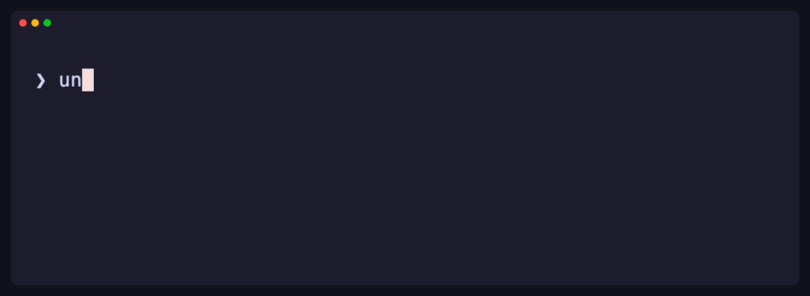
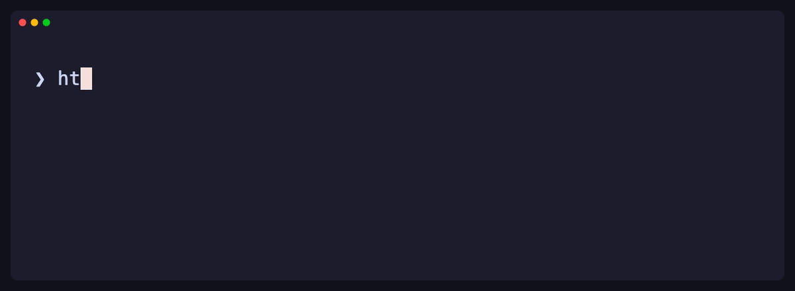

<h1 align="center">undetected-httpx 2.0</h1>

<p align="center">
  
  
  <a href="LICENSE"></a>
</p>

> **undetected-httpx** is an HTTP probing toolkit built on [ProjectDiscovery's httpx](https://github.com/projectdiscovery/httpx), with browser TLS and HTTP/2 fingerprints powered by [HTTPCloak](https://github.com/sardanioss/httpcloak).

Version 2.0 replaces the Python wrapper with a **Go fork of httpx v1.12.0**. You get the upstream probes, flags and output formats, with **HTTPCloak v1.7.3** handling the main HTTP transport. The default browser profile is `chrome-latest`.

-----

## 📦 Installation

Install with **Go 1.26.0+**:

```bash
go install github.com/Michele0303/undetected-httpx/v2/cmd/undetected-httpx@latest
```

Use `@v2.0.0` instead of `@latest` to pin the release. Add your Go binary directory to `PATH`: `$GOBIN`, or `$(go env GOPATH)/bin` when `GOBIN` is unset.

Prebuilt Linux and macOS binaries are available in the [releases](https://github.com/Michele0303/undetected-httpx/releases).

<details>
<summary>Build from a source checkout</summary>

```bash
git clone --branch v2.0.0 https://github.com/Michele0303/undetected-httpx.git
cd undetected-httpx
make build
./bin/undetected-httpx -h
```

Run `make install` to install the command in your Go binary directory.

</details>

The previous Python package remains in [legacy/python](legacy/python); see the [migration guide](docs/V2-MIGRATION.md) when upgrading.

-----

## 🎭 Real-world Comparison

On the same five selected URLs, with the same User-Agent, **httpx returned `403 Forbidden`** while **undetected-httpx returned `200 OK`**.

<table>
  <tr>
    <td align="center" width="50%">
      <kbd><b>undetected-httpx 2.0</b></kbd><br><br>
      
    </td>
    <td align="center" width="50%">
      <kbd>httpx v1.12.0 (Original)</kbd><br><br>
      
    </td>
  </tr>
</table>

**Real tool executions**, recorded with VHS on 16 October 2026. These examples highlight improvements from our **96-host comparison across 32 site groups**. Results vary by site; a `200` response can still contain a challenge page.

[Watch the MP4](docs/demos/v2-live/comparison.mp4) · [Full benchmark](docs/benchmarks/2026-10-16/README.md) · [Reproduce the recordings](docs/demos/v2-live/README.md)

-----

## 📊 Technical Capabilities

| Feature | `undetected-httpx 2.0` | `httpx v1.12.0` |
| :--- | :--- | :--- |
| **Network stack** | HTTPCloak | Go `net/http` |
| **Default TLS fingerprint** | Browser profile (`chrome-latest`) | Upstream default |
| **Selected demo results** | ✅ **5 × HTTP 200** | **5 × HTTP 403** |
| **Probes & output** | httpx probes, text and JSONL | httpx probes, text and JSONL |

### 🛠 Key Features

- **Browser transport:** browser TLS, HTTP/2 settings and headers through HTTPCloak, with HTTP/1.1 fallback.
- **Familiar CLI:** keep the httpx probing pipeline, retries and output formats; select a profile with `--browser` or `-impersonate`.
- **Native mode:** use `--native-http` for custom resolvers, IP/network controls, TLS certificate probes and raw requests.

Browser impersonation does not guarantee access or solve JavaScript challenges. This adapter supports HTTP/1.1 and HTTP/2; see the [compatibility table](docs/V2-MIGRATION.md#transport-compatibility) for supported options.

-----

## 🚀 Usage

```bash
# Probe targets and show status codes and titles.
undetected-httpx -l targets.txt -sc -title

# Choose a browser profile and write JSONL.
undetected-httpx -u https://example.com --browser chrome-latest -json

# Use the native transport for TLS and IP probes.
undetected-httpx -u https://example.com --native-http -tls-grab -ip
```

Run `make test` for local regressions. [Validation results](docs/benchmarks/2026-10-16/validation.md) · [Upstream & licenses](docs/UPSTREAM.md)
